<!-- Repo files needed: banner.svg, code-card.svg, footer-waves.svg (all in repo root). Check the Fizzy Studios link (fizzystudio.xyz). -->
<!-- No GitHub Action / external stat services needed — nothing here can break. -->

 

 

I'm Abdur Rehman, CEO and developer at **[Fizzy Studios](https://fizzystudio.xyz)** — a small software studio I run on my own. I build developer tools, ranking and licensing systems, Minecraft plugins, and Discord bots. Most of what I make, I sell as ready-to-use resources on **[BuiltByBit](https://builtbybit.com/members/abdur-rehman.800917/)**. I mainly work with TypeScript and Node, build the front-end side in React and Next.js, and use Java when a Minecraft plugin needs it.

 

 

