<!-- Only thing to double-check: the Fizzy Studios link (fizzystudio.xyz). Everything else is live. -->

<div align="center">


<br/>

<a href="https://github.com/AbdurRehman1098"></a>
<a href="https://builtbybit.com/members/abdur-rehman.800917/"></a>


</div>

<br/>

```ts
const abdur = {
  role:   "CEO & Developer",
  studio: "Fizzy Studios",
  stack:  ["TypeScript", "Node.js", "React", "Next.js", "Java"],
  builds: ["Discord Bots", "Minecraft Plugins", "Licensing Systems", "APIs"],
  shop:   "builtbybit.com/members/abdur-rehman.800917",
};
```

I run **[Fizzy Studios](https://fizzystudio.xyz)** as CEO & developer — an independent studio where I ship production-ready developer tools, ranking & licensing systems, Minecraft plugins and Discord automation. Most of my work ends up as premium resources on **[BuiltByBit](https://builtbybit.com/members/abdur-rehman.800917/)**. I live in TypeScript and Node, build front-ends in React/Next, and reach for Java when a Minecraft plugin calls for it.

<br/>

<div align="center">


</div>

<br/>

<div align="center">


<br/>


</div>

<br/>

<div align="center">



</div>

<br/>

<div align="center">

[](https://fizzystudio.xyz)
[](https://builtbybit.com/members/abdur-rehman.800917/)
[](https://github.com/AbdurRehman1098)
[](mailto:abdurrehmansabir15@gmail.com)

</div>


